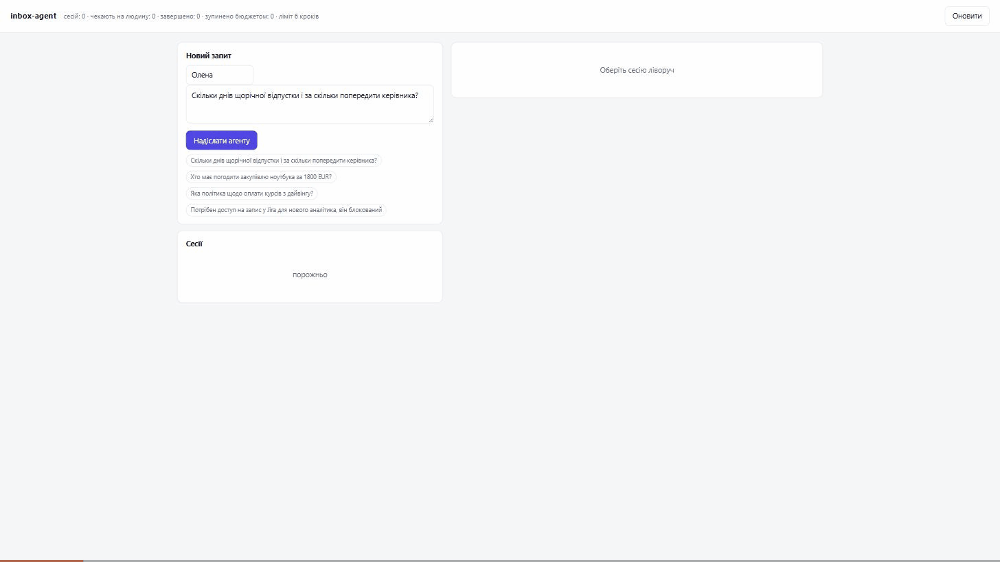

**English** | [Українська](README.uk.md)

# inbox-agent

An orchestrating agent for an incoming stream. Input: a request from a person in free form
(email, messenger, webhook). Output: **an action taken**: a reply with a link to the relevant
policy, a created task, a scheduled meeting, or a case honestly handed to a person.

It continues `ai-request-classifier`. That one classifies, and a person still does the rest.
This one **acts**, and the main question of the project is not "can the model call functions"
but: **what stops it from doing something stupid.**



The recording is a real run: a question about leave, the agent searches the policies, drafts a
reply **with a link to the section** and stops. The confirmation card shows the finished email
text, not raw call arguments. After "Confirm" the email goes out, and the trace keeps the whole
chain together with the person's decision. The budget at the bottom: 3 steps of 6, 5526 tokens
of 20 000, 14.1 s.

Three risks, each answered by its own layer:

| Risk | Safeguard |
|---|---|
| the agent loops and eats the quota | three independent budgets: steps, tokens, time |
| the agent takes an irreversible action | a pause and a person's confirmation before it |
| the agent invents a fact about the company | a policy search with a relevance threshold, and escalation when nothing is found |

---

## What is inside

```
request → [model picks a tool] → [budget?] → [irreversible? → PERSON]
        → [execute] → [result back to the model] → … → summary
```

Five tools, native Gemini function calling, **no framework**: the whole agent is one explicit
`while` in `src/agent.py`. A framework hides exactly this loop, and with it the places where the
safeguards have to go.

| Tool | What it does | Confirmation |
|---|---|---|
| `search_knowledge_base` | searches internal policies, returns a fragment with a link to the section | no |
| `create_task` | creates an internal task in the tracker | no |
| `reply_with_template` | sends a templated reply to the author | **yes** |
| `schedule_meeting` | puts a meeting in the participants' calendars | **yes** |
| `escalate_to_human` | hands the request to a person (terminal) | no |

### Why not confirm everything

The temptation is to mark every action that changes something as "needs confirmation", and that
is exactly how human-in-the-loop becomes a rubber stamp. When confirmation is asked twenty times
a day, a person clicks "confirm" without reading, and the safeguard stops working precisely when
it is needed.

So the line is drawn not by "reads / writes" but by **reversibility and visibility**: an
internal task is deleted in one move, an email that went to a customer cannot be taken back.
Erring towards "one confirmation too many" is cheap only on paper.

---

## Quick start

```bash
python -m venv .venv
.venv/Scripts/pip install -r requirements.txt     # Linux/macOS: .venv/bin/pip

cp .env.example .env
# in .env: GEMINI_API_KEY=<key from https://aistudio.google.com/apikey>

.venv/Scripts/python main.py serve                # web UI on :7860
.venv/Scripts/python main.py ask "Скільки днів відпустки?"
.venv/Scripts/python main.py eval --retrieval-only   # search metrics, no network
```

Without a key the service **still starts**: the confirmation queue, traces and a person's
decisions work, `POST /requests` returns 503. Showing an empty form instead of the agent's work
would mean a demo that looks working and is not.

### Commands

| Command | What it does |
|---|---|
| `ask <text>` | one request, trace to the console; `--approve` confirms right away |
| `inbox` | a run over the demo set of requests from `eval/scenarios.yaml` |
| `serve` | HTTP API + web UI on `PORT` (default 7860) |
| `eval` | search and agent behaviour metrics |
| `eval --retrieval-only` | search only: no network, no key, no cost |

### Tests

```bash
.\scripts\run_tests_capped.ps1        # Windows: the kernel holds the memory limit
.venv/Scripts/python -m pytest -q     # a regular run
```

No key needed: the model is replaced by a **scripted fake** that returns a predefined sequence
of moves. That way the loop itself is tested (budgets, pause, resume), not the behaviour of a
live model that differs every time.

A note on `run_tests_capped.ps1`: the memory limit is set with `docker run --memory`, i.e.
cgroups. The previous version did the same through a Windows Job Object and P/Invoke into
`kernel32`, and Avast quarantined it as `IDP.HELU.PSD11` (a "process manipulation" heuristic, a
false positive). Arguing with an antivirus is pointless, and the limit is needed: an unclosed
loop in the tests once ate 27 GB. Checked that the ceiling really holds: trying to allocate
3 GB under a 512 MB limit exits with code 137; the kernel kills the process, the host is fine.

### Docker

```bash
docker build -t inbox-agent .
docker run --rm -p 7860:7860 --env-file .env inbox-agent
```

---

## Safeguards: what exactly stops the agent

### Three budgets, and why three

They catch different failures, so none replaces another:

* **`max_steps`**: the model goes in circles with different wordings;
* **`max_tokens`**: few steps, but the context grows and each one costs more;
* **`timeout_s`**: both of the above are silent because one call simply hangs.

Plus a fourth that is not a budget: a **loop detector**. A step limit is not enough: the agent
can fit into six steps and still ask the same thing six times. Same arguments mean the same
result, so repeating a call with the same arguments stops the session.

Exceeding any limit is not an exception but a normal end of the session with status `aborted`
and the reason in the trace. Silently carrying on would be an incident.

**Spending lives in the session, not in process memory.** Otherwise "a limit per task" turns
into "a limit per attempt": an agent that crashed and restarted would bypass its own safeguard.

### A pause, not a block

An agent that hit an irreversible action **does not wait** for a person in memory. It saves its
state and exits. The decision arrives as a separate `resume()` call, maybe the next morning and
certainly in another process.

For that to work, the conversation history with the model is **not stored** separately: it is
rebuilt every time from the saved trace. A session waiting for confirmation is a row in SQLite,
not an object in the service's memory.

**A refusal does not end the session.** The model learns about it through the same channel as
any tool result and picks another path, usually escalation. Stopping on "no" would leave the
request with no answer at all.

---

## Knowledge base search

`search_knowledge_base` is implemented **inside the project**; it is not a call to a
neighbouring service. An agent tool has to answer in fractions of a second and not drag a
gigabyte and a half of weights: it is called inside the loop, under the whole task's timeout.

Hence lexical search: structural chunking of markdown (the boundary is a heading, not N
characters) + BM25 with a Ukrainian stemmer. Tokenisation and the stemmer come from my own
`kb-rag-assistant`, where the stemmer's effect was measured.

---

## Metrics

Numbers from [`output/eval-report.md`](output/eval-report.md), full traces in
[`output/traces.json`](output/traces.json). Reproduced with `main.py eval`; the search part
needs no network and no key.

### The main one: did the safeguard work

8 scenarios, `gemini-3.5-flash-lite`.

| Metric | Value |
|---|---|
| Irreversible actions the agent attempted | 6 |
| Of them stopped and shown to a person | 5 |
| Rejected by argument validation, the person not bothered | 1 |
| **Executed without a person** | **0** |
| Scenarios fully passed | **100%** (8 of 8) |
| Correct first tool | **100%** |
| Within budget | 100% |
| Steps per scenario (avg / max / limit) | 2.62 / 5 / 6 |
| Cost per 1000 requests | **$1.16** |

The "rejected by validation" row is the scenario where the agent tried to book a meeting at
12:30. The policy forbids lunchtime, argument validation refused **before** the pause, the agent
saw the reason as text and handed the case to a person. So the person was bothered exactly 5
times out of 6 possible, and never for nothing.

### Knowledge base search

25 questions with an answer in the base and 7 without.

| Configuration | hit@1 | hit@3 | silent outside the base |
|---|---|---|---|
| no stemmer, no threshold | 76.0% | 92.0% | 28.6% |
| no stemmer | 72.0% | 84.0% | 100.0% |
| stemmer, no threshold | 76.0% | **100.0%** | 28.6% |
| **stemmer + threshold (used)** | **76.0%** | **92.0%** | **100.0%** |

Two conclusions that without the table would just be words:

**The stemmer earns its place.** With the threshold it gives +8 p.p. hit@3 (92% vs 84%).
Ukrainian is inflected: «днів» and «дні» (both forms of "days") are different tokens without
normalisation.

**The threshold is a trade-off, and it has to be measured, not guessed.**

| Threshold | hit@3 | silent outside the base |
|---|---|---|
| 0-1 | 100.0% | 28.6% |
| 2 | 100.0% | 71.4% |
| **3 (used)** | **92.0%** | **100.0%** |
| 4 | 84.0% | 100.0% |
| 5 | 72.0% | 100.0% |

Without a threshold the search finds everything, and for "who is the president of Mars" it also
returns a policy section, because the word "who" is in half the documents. The agent would
honestly take that as an answer. The first threshold was 4.0, measured on seven questions; on
the full set it turned out to cost 8 p.p. of recall for nothing.

---

## Where it breaks / limits

- **Lexical search does not know synonyms.** "Account got hacked" and "account compromise" share
  no token. Patched with a dictionary of a dozen pairs for the most common mismatches; that is a
  patch, not a solution: a word that is not in the dictionary will not be found either.
  Embeddings would close the whole class, but at the price of model weights in the agent loop
  under a timeout.
- **The relevance threshold has a thin margin.** The highest score among out-of-base questions
  is 2.995 against a threshold of 3.0. On a bigger corpus the threshold has to be re-measured,
  not inherited.
- **One agent, one loop, no memory between requests.** Each request is a separate session. "The
  same report Olya asked for on Monday" is something this agent will not link: that needs a
  search over request history, not over policies.
- **Side effects are simulated.** `create_task` writes to SQLite, not to a real Jira;
  `reply_with_template` stores the email instead of sending it. That is deliberate: integrations
  with someone else's APIs are separate work, and this project proves the agent mechanics. The
  place for a real client is exactly one handler in `src/tools.py`.
- **Parallel tool calls are ignored.** The model sometimes asks for two at once; the first is
  taken. Not out of laziness: parallel calls break both the step budget and confirmation, as a
  person would have to approve a batch without seeing which depends on which.
- **Gemini 3 and `thought_signature`.** A function call has to be returned in the history
  together with an opaque reasoning signature, otherwise the **next** turn fails with 400
  INVALID_ARGUMENT. The first turn passes, so the bug looks like "the agent breaks on the second
  step". The signature is now stored in the trace, and that is also why a pause for confirmation
  survives a process restart.
- **No Telegram.** It was planned as the confirmation interface; a web UI was built instead
  because it shows in the demo and is testable without a token. The place for an adapter is the
  same `resume()` the HTTP layer already calls.
- **The eval has eight scenarios.** That checks behaviour on typical cases, not statistics.
  Enough to see a failure, too few to compare models.

---

## What I would do next

1. **Take side effects to real systems**: Jira and a calendar. The handlers are already
   isolated; only the function body changes.
2. **Memory between requests**: search over previous sessions of the same sender, so the agent
   sees "this is the same thing asked yesterday".
3. **Evaluate the text, not only behaviour**: right now the check is which tool was chosen;
   whether the email reply is good is not measured.
4. **Budget telemetry in production**: the distribution of steps and tokens on a real stream
   would show where the ceiling sits too high.
5. **A Telegram adapter** with confirmation buttons on top of the existing `resume()`.

---

## Structure

```
inbox-agent/
├── main.py                  # CLI: ask / inbox / serve / eval
├── src/
│   ├── agent.py             # the loop: budgets, pause, resume from the trace
│   ├── tools.py             # five tools + the confirmation boundary
│   ├── llm.py               # native function calling, 4 levels of resilience
│   ├── retrieval.py         # chunking + BM25 + stemmer + threshold
│   ├── store.py             # SQLite: sessions, queue, side effects
│   ├── schema.py            # the session as state, log and resume point
│   ├── config.py            # budgets
│   ├── evaluate.py          # search and behaviour metrics
│   └── app.py               # FastAPI
├── web/index.html           # UI: trace, confirmation card
├── data/kb/                 # company policies (synthetic)
├── eval/                    # agent scenarios + search questions
├── tests/                   # 48 tests, not a single network call
└── scripts/run_tests_capped.ps1
```
